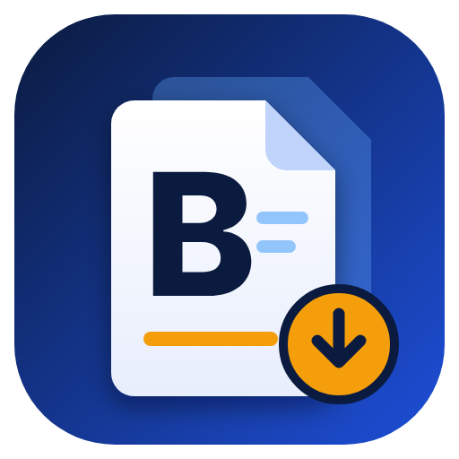
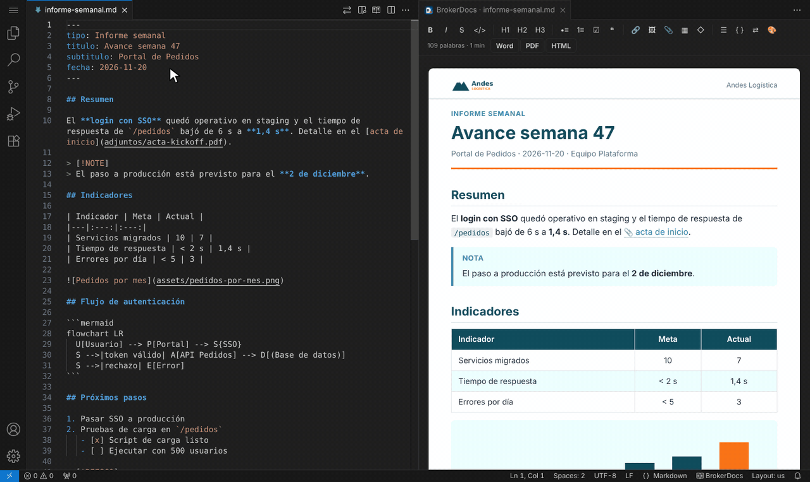

<p align="center"></p>

<h1 align="center">BrokerDocs</h1>
<p align="center"><b>Markdown con la marca de tu empresa → Word y PDF.</b><br>Extensión para VS Code · Plugin para Claude Code · CLI</p>

---

<p align="center"></p>

Escribe en Markdown y obtén documentos con logo, colores, fuentes, encabezado, pie y diagramas, sin plantillas de Word ni pasos manuales. El mismo motor funciona en tres lugares:

| | Para qué |
|---|---|
| **Extensión de VS Code** | Vista previa en vivo con tu marca, edición rápida, imágenes y adjuntos, selección sincronizada código ↔ vista, exportación a Word/PDF/HTML. |
| **Plugin de Claude Code** | `/brokerdocs:diario`, `/brokerdocs:semanal`, `/brokerdocs:issue 12`: redacta el avance a partir de git/GitHub y lo exporta a Word con tu marca. |
| **CLI** | `node brokerdocs.js export informe.md --to all` para scripts o CI. |

Un documento exportado desde VS Code o desde Claude Code sale **idéntico**: ambos leen la misma marca desde `.brokerdocs/brand.json`.

## Instalación

### Plugin para Claude Code

```bash
claude plugin marketplace add gmbeas/BrokerDocs
claude plugin install brokerdocs@brokerdocs
```

También se puede hacer dentro de una sesión: `/plugin marketplace add gmbeas/BrokerDocs` y luego `/plugin install brokerdocs@brokerdocs`.

| Comando | Qué hace |
|---|---|
| `/brokerdocs:diario [fecha] [notas]` | Avance del día |
| `/brokerdocs:semanal [fecha] [notas]` | Informe semanal |
| `/brokerdocs:issue <n>` | Documenta un issue (usa `gh` si está disponible) |
| `/brokerdocs:exportar <archivo.md> [docx\|pdf\|html\|all]` | Exporta cualquier Markdown |
| `/brokerdocs:marca [init\|show]` | Crea o muestra la marca del proyecto |

También responde a pedidos en lenguaje natural, como "documenta el avance de hoy" o "exporta este md a PDF".

**Requisitos:** Node 18+ (el mismo que usa Claude Code). Para el PDF y los diagramas usa Chrome, Edge o Chromium si están instalados; si no, los diagramas van como código y el PDF se reemplaza por HTML.

**Consumo:** unos 160 tokens fijos por sesión. El formato lo aplica la herramienta, no el modelo.

### Extensión para VS Code

1. Descarga `brokerdocs-x.y.z.vsix` desde [Releases](https://github.com/gmbeas/BrokerDocs/releases).
2. En VS Code: Extensiones → `···` → **Install from VSIX…**

   No hagas doble clic en el archivo: en Windows abre el instalador de Visual Studio, que es otro programa.
3. Abre un `.md` y presiona `Ctrl+Alt+M`, o elige *Reopen Editor With… → BrokerDocs*.

Más detalles en [extension/README.md](extension/README.md).

## Tu marca

```bash
node <ruta>/brokerdocs.js brand init     # o el botón 🎨 en VS Code, o /brokerdocs:marca init
```

```json
{
  "empresa": "BrokerTech",
  "logo": "logo.png",
  "fuente": "Calibri",
  "colores": { "primario": "1E40AF", "secundario": "0EA5E9", "acento": "F59E0B" },
  "pie": "Documento interno"
}
```

Guarda el logo en `.brokerdocs/logo.png`. La marca se busca subiendo desde la carpeta del documento, así que puede haber una por proyecto o por carpeta.

## Markdown soportado

Front matter (`tipo`, `titulo`, `subtitulo`, `fecha`, `autor`) para la portada, títulos, negrita, cursiva, tachado, código, enlaces, imágenes locales, listas anidadas y de tareas, tablas con alineación, bloques de código con resaltado, notas (`> [!NOTE]`, `> [!WARNING]`, `> [!RIESGO]`, `> [!BLOQUEO]`…), separadores y diagramas `mermaid`.

## Estructura del repositorio

```
.claude-plugin/marketplace.json   catálogo del plugin
plugin/                           plugin (skill, plantillas, comandos y CLI compilado)
extension/                        extensión de VS Code y código fuente del motor y el CLI
```

## Desarrollo

```bash
cd extension
npm install
npm run build        # compila la extensión y regenera plugin/skills/documentar/scripts/brokerdocs.js
npm run package      # genera brokerdocs-x.y.z.vsix
```

Para probar la extensión, abre `extension/` en VS Code y presiona F5. Para probar el plugin sin instalarlo: `claude --plugin-dir ./plugin`.

Al publicar un tag `vX.Y.Z`, GitHub Actions compila el `.vsix` y lo adjunta a la release.

## Licencia

MIT
