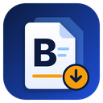

# BrokerDocs — Markdown con marca, Word y PDF



**Escribe en Markdown y obtén documentos con la identidad de tu empresa.** BrokerDocs es una vista previa para VS Code que aplica tu logo, colores y fuentes en vivo, y exporta a Word y PDF con un clic, sin plantillas ni pasos manuales.

## Funciones

- **Vista en vivo con tu marca**: logo, colores, fuentes, encabezado y pie. Lo que ves es lo que se exporta.
- **Edición rápida**: barra con negrita, títulos, listas, tareas, notas, tablas, enlaces y diagramas. `Ctrl+B` / `Ctrl+I` en el editor.
- **Imágenes y adjuntos**: pega (`Ctrl+V`) o arrastra archivos sobre la vista. Las imágenes se guardan en `assets/` y los adjuntos en `adjuntos/`, y BrokerDocs inserta el enlace.
- **Enlaces inteligentes**: los enlaces a otros `.md` se abren en el editor, los adjuntos con su aplicación (Word, Excel, PDF…) y los rotos se marcan en rojo.
- **Diagramas de flujo** con Mermaid, coloreados con tu marca. Se cargan solo si el documento los usa.
- **Notas destacadas**: `> [!NOTE]`, `> [!TIP]`, `> [!WARNING]`, `> [!CAUTION]` o en español `> [!RIESGO]`, `> [!BLOQUEO]`.
- **Índice lateral**, contador de palabras y tiempo de lectura.
- **Exportación**:
  - **Word (.docx)**: estilos reales de Word (Título 1, 2…), tablas, listas, imágenes, diagramas, encabezado con logo y "Página X de Y".
  - **PDF**: usa el Chrome o Edge que ya tienes instalado; no se descarga ningún navegador.
  - **HTML autónomo**: un solo archivo con las imágenes incluidas, listo para enviar.
- **Doble clic** en la vista lleva a esa línea en el editor; el desplazamiento del editor y la vista va sincronizado.

## Tu marca en 30 segundos

Pulsa 🎨 en la vista (o **BrokerDocs: Editar marca**) para elegir colores, paleta, logo y fuentes con vista previa. Se guarda en `.brokerdocs/brand.json`:

```json
{
  "empresa": "ACME",
  "logo": "logo.png",
  "fuente": "Calibri",
  "colores": { "primario": "1E40AF", "secundario": "0EA5E9", "acento": "F59E0B" },
  "pie": "Documento interno"
}
```

Pon tu logo en `.brokerdocs/logo.png` y guarda: la vista se actualiza sola. El archivo tiene autocompletado y validación.
Es compatible con el `brand.json` del plugin **BrokerDocs para Claude Code** ([repositorio](https://github.com/gmbeas/BrokerDocs)): ambos exportan igual.

## Título del documento (opcional)

```markdown
---
tipo: Informe semanal
titulo: Avance semana 47
subtitulo: Portal de Pedidos
fecha: 2026-11-22
autor: Equipo Plataforma
---
```

## Atajos

| Acción | Windows/Linux | Mac |
|---|---|---|
| Abrir vista BrokerDocs | `Ctrl+Alt+M` | `Cmd+Alt+M` |
| Negrita / Cursiva | `Ctrl+B` / `Ctrl+I` | `Cmd+B` / `Cmd+I` |
| Insertar enlace | `Ctrl+K Ctrl+L` | `Cmd+K Cmd+L` |

## Configuración principal

| Ajuste | Por defecto | Descripción |
|---|---|---|
| `brokerdocs.export.pageSize` | `Letter` | `Letter` (carta) o `A4` |
| `brokerdocs.imagesFolder` | `assets` | Carpeta para imágenes pegadas |
| `brokerdocs.attachmentsFolder` | `adjuntos` | Carpeta para adjuntos |
| `brokerdocs.export.browserPath` | (automático) | Chrome/Edge para generar PDF |
| `brokerdocs.brand` | `{}` | Marca directa en la configuración |

## Liviana por diseño

- Se activa solo con archivos Markdown.
- Mermaid (el motor de diagramas) se carga solo si el documento tiene diagramas.
- Usa el navegador del sistema para el PDF, en lugar de incluir uno de 150 MB.
- Sin telemetría y sin conexión a internet.

## Desarrollo

```bash
npm install
npm run watch      # compila en modo vigilancia; F5 abre VS Code con la extensión
npm run package    # genera brokerdocs-x.y.z.vsix
```
