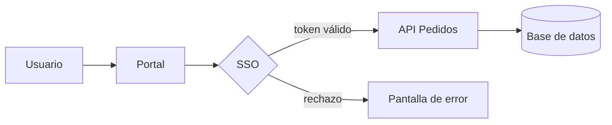

## Resumen

La migración avanza **según plan**: el 70 % de los servicios ya corre en la nueva plataforma y el login con *SSO* está en staging. Detalle técnico en [la guía de arquitectura](arquitectura.md) y el contrato en [contrato firmado](adjuntos/contrato.pdf).

> [!NOTE]
> El corte a producción está previsto para el **2 de diciembre**.

## Indicadores

| Indicador | Meta | Actual |
|---|:---:|---:|
| Servicios migrados | 10 | 7 |
| Tiempo de respuesta | < 2 s | 1,4 s |
| Errores por día | < 5 | 3 |


## Flujo de autenticación



## Tareas

1. Migrar servicio de facturación
   - [x] Esquema de base de datos
   - [ ] Pruebas de carga
2. Configurar monitoreo con `prometheus`

> [!WARNING]
> El certificado del IdP vence el 30/11. Sin renovación, el SSO deja de funcionar.

## Ejemplo de configuración

```yaml
sso:
  provider: azure-ad
  timeout: 30 # segundos
```

---

Más información en <https://example.com/docs> · enlace roto de prueba: [no existe](falta.md)
