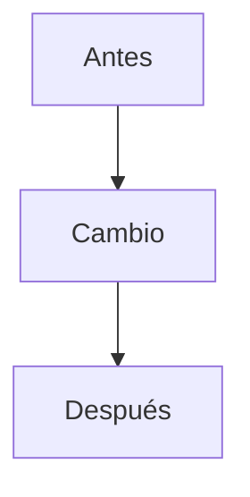

## Contexto
{qué problema o requerimiento plantea el issue, en 2–3 líneas}

## Solución / avance
{qué se hizo y por qué}

## Cambios realizados
| Archivo / área | Cambio |
|---|---|
| `{ruta}` | {descripción} |

## Pruebas
- [x] {prueba realizada}
- [ ] {prueba pendiente}

## Pendiente
1. {siguiente paso}
