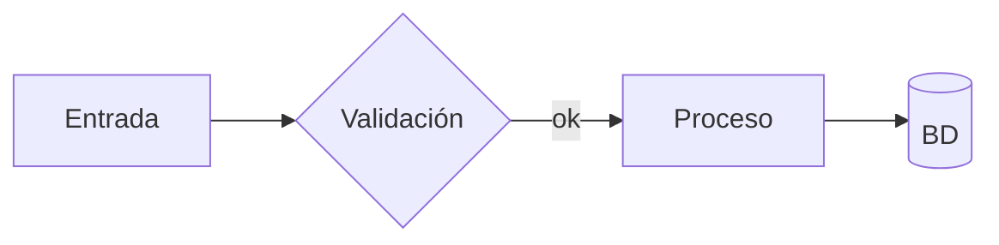

## Resumen ejecutivo
{3–4 líneas para alguien que no ve el código: logros, estado, riesgos}

## Indicadores
| Indicador | Valor |
|---|---|
| Commits | {n} |
| Líneas | +{add} / -{del} |
| PRs cerrados | {n} |

## Logros de la semana
- **{área}:** {resultado, no la tarea}

## Flujo / arquitectura (opcional, solo si cambió algo relevante)

## Riesgos y bloqueos
> [!RIESGO]
> {descripción e impacto}

## Plan próxima semana
1. {objetivo}
